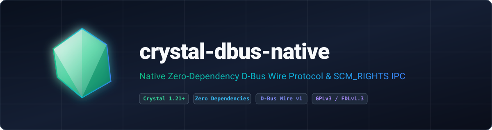

<p align="center">
  
</p>

<p align="center">
  <strong>Native, zero-dependency D-Bus wire protocol for Crystal featuring BodyCodec marshaling, SASL EXTERNAL authentication, and SCM_RIGHTS UNIX file descriptor passing.</strong>
</p>

<p align="center">
  <a href="https://gitlab.com/renich/crystal-dbus-native/-/releases"></a>
  <a href="https://crystal-lang.org/">= 1.21.0" /></a>
  <a href="https://gitlab.com/renich/crystal-dbus-native/-/pipelines"></a>
  <a href="https://gitlab.com/renich/crystal-dbus-native"></a>
  <a href="https://github.com/crystal-ameba/ameba"></a>
  <a href="https://github.com/kdairatchi/flaw"></a>
</p>

<p align="center">
  <a href="https://renich.gitlab.io/crystal-dbus-native/"></a>
  <a href="https://renich.gitlab.io/crystal-dbus-native/technical/api/"></a>
  <a href="LICENSE"></a>
  <a href="https://liberapay.com/Renich/donate"></a>
</p>

> **GitLab Project Metadata**:
> - **Description**: Native, zero-dependency D-Bus wire protocol for Crystal featuring BodyCodec marshaling, SASL EXTERNAL authentication, and SCM_RIGHTS UNIX file descriptor passing.
> - **Topics and Tags**: `crystal`, `crystal-lang`, `dbus`, `ipc`, `linux`, `unix-sockets`, `scm-rights`, `zero-dependencies`, `security`, `gplv3`

---

## Overview

**crystal-dbus-native** provides a pure, zero-dependency Crystal implementation of the **D-Bus wire protocol v1**, general-purpose body marshaling (`BodyCodec` and `Variant`), SASL `EXTERNAL` authentication with `NEGOTIATE_UNIX_FD` negotiation, and out-of-band UNIX domain socket file descriptor passing (`SCM_RIGHTS`).

### Key Highlights

1. **Zero C-Library Dependencies**: Communicates directly with Linux system and session UNIX domain sockets without `libdbus-1` or `libsystemd` FFI bindings.
2. **Complete Body Marshaling (`BodyCodec` & `Variant`)**: Encodes and decodes all basic D-Bus types, nested structs (`StructValue`), dictionaries (`a{sv}`), `Variant`, `ObjectPath`, `Signature`, and `UnixFD` in both little-endian and big-endian formats with 1, 2, 4, and 8-byte alignment enforcement.
3. **Secure `SCM_RIGHTS` File Descriptor Passing**: Wraps `sendmsg`/`recvmsg` with `MSG_CMSG_CLOEXEC` and guarantees automatic descriptor cleanup on `MSG_CTRUNC` truncation or framing errors.
4. **RPC Correlation & Signal Queueing**: `DBusConnection#call` correlates request-reply serials while preserving interleaved `Signal` frames in a thread-safe queue (`poll_signal`).
5. **Defensive Signature Validation**: Validates D-Bus signatures (`SignatureValidator`) up to 255 bytes with independent 32-level array and struct depth limits.

---

## Installation

Add `crystal-dbus-native` to your application's `shard.yml`:

```yaml
dependencies:
  crystal-dbus-native:
    gitlab: renich/crystal-dbus-native
    version: ~> 0.3.0
```

Then install the shard:

```bash
shards install
```

---

## Usage

```crystal
require "crystal-dbus-native"

# Connect to the session or system bus and perform SASL + Hello handshake
connection = Crystal::Dbus::Native::DBusConnection.open_session
unique_name = connection.start(negotiate_unix_fd: true)
puts "Connected to D-Bus (unique name: #{unique_name}, GUID: #{connection.server_guid})"

# Invoke a D-Bus method and decode its reply body
reply = connection.call(
  destination: "org.freedesktop.DBus",
  path: "/org/freedesktop/DBus",
  interface: "org.freedesktop.DBus",
  member: "GetId"
)
puts "Bus ID: #{reply.decode_body.first}"

connection.close
```

---

## Build System Targets

The repository includes a comprehensive, standard `GNUmakefile`:

| Target | Description |
| :--- | :--- |
| `make all` | Runs `lint`, `doc-check`, and `test` |
| `make test` | Executes the spec test suite (`crystal spec`) |
| `make lint` | Runs `crystal tool format --check`, Ameba (`--all`), and Flaw SAST scanner |
| `make doc-check` | Lints all reStructuredText files using `crstlint` and `rstcheck` |
| `make check` | Alias for `all` (`lint`, `doc-check`, and `test`) |
| `make format` | Formats all Crystal source and spec files |
| `make docs` | Generates Crystal API docs and Sphinx `dirhtml` documentation |
| `make deps` | Installs Shards dependencies and builds `bin/ameba` and `bin/flaw` |
| `make clean` | Removes build artifacts, generated docs, and caches |

---

## Documentation

Full architectural blueprints, functional specifications, and operational playbooks are maintained under [`docs/`](docs/index.rst):

| Guide | Scope & Highlights | Entry Point |
| :--- | :--- | :--- |
| **Business Context & Strategy** | Ecosystem problem statement, ROI metrics, and user personas. | [Business Specs](docs/business/spec.rst) |
| **Functional Specifications** | Requirements [FUNC-001]–[FUNC-007] and traceability matrix. | [Functional Specs](docs/functional/spec.rst) |
| **Technical Architecture** | Specifications [TECH-001]–[TECH-007], D2 diagrams, and threat model. | [Technical Specs](docs/technical/spec.rst) |
| **Release Playbook** | SemVer, Keep a Changelog, and GPG-signed GitLab release steps. | [Release Procedure](docs/technical/specs/release-procedure.rst) |
| **Architecture Decisions (ADRs)** | Immutable logs of architectural decisions and trade-offs. | [ADR Index](docs/adrs/index.rst) |
| **Project Roadmap** | Phased milestone tracking, task dependencies, and critical paths. | [Project Roadmap](docs/project/roadmap.rst) |
| **User Guides** | Installation, RPC usage, and error handling examples. | [User Manual](docs/user/index.rst) |
| **Crystal API Reference** | Complete interactive type hierarchy and method signatures. | [API Reference](https://renich.gitlab.io/crystal-dbus-native/technical/api/) |

---

## Contributing & Code of Honor

All contributions must adhere to the [Universal Code of Honor](CODE_OF_HONOR.rst) and [Contributing Guidelines](CONTRIBUTING.rst).

---

## License

- **Software**: GNU General Public License v3.0 or later ([LICENSE](LICENSE)).
- **Documentation**: GNU Free Documentation License v1.3 or later ([LICENSE-DOCS](LICENSE-DOCS)).

Copyleft &copy; 2026 Rénich Bon Ćirić &lt;renich@evalinux.com&gt;.

---

## Support & Donations

If you find this shard useful and wish to support its ongoing development, please consider donating:

<p align="center">
  <a href="https://liberapay.com/Renich/donate">
    
  </a>
</p>
