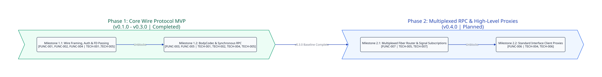

===============
Project Roadmap
===============

Overview
--------

This document tracks the phased implementation milestones, deliverable tasks, dependency graphs, and bidirectional requirement traceability for ``crystal-dbus-native``.

Macro Timeline Diagram
----------------------

Phase Summary
-------------

.. list-table::
   :header-rows: 1
   :widths: 20 15 15 50

   * - Phase
     - Target Release
     - Status
     - Scope & Requirements
   * - :doc:`Phase 1: MVP <roadmaps/phase-1-mvp>`
     - ``v0.3.0``
     - Completed
     - SASL ``EXTERNAL`` and ``NEGOTIATE_UNIX_FD``, ``SignatureValidator``, ``HeaderCodec``, ``BodyCodec``/``Variant``, ``SecureFDPasser`` ``SCM_RIGHTS``, and synchronous ``DBusConnection#call`` (``[FUNC-001]``..``[FUNC-005]``, ``[TECH-001]``..``[TECH-005]``).
   * - :doc:`Phase 2: Enhancement <roadmaps/phase-2-enhancement>`
     - ``v0.3.1``
     - Completed
     - Background reader fiber with ``Hash(UInt32, Channel(DBusMessage))`` pending reply demultiplexer, ``AddMatch``/``RemoveMatch`` signal subscription channels, and typed ``org.freedesktop.DBus.Properties`` and ``Introspectable`` client proxies (``[FUNC-006]``, ``[FUNC-007]``, ``[TECH-004]``, ``[TECH-005]``, ``[TECH-006]``, ``[TECH-007]``).

.. toctree::
   :maxdepth: 1
   :caption: Roadmap Phases

   roadmaps/phase-1-mvp
   roadmaps/phase-2-enhancement
   audits/index
