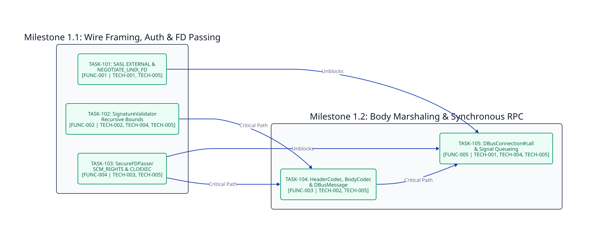

============
Phase 1: MVP
============

Timeline & Objectives
---------------------

Deliver the complete zero-dependency D-Bus wire protocol v1 framing, SASL ``EXTERNAL`` authentication with ``NEGOTIATE_UNIX_FD``, recursive signature validation, ``SCM_RIGHTS`` file descriptor passing, recursive ``BodyCodec`` marshaling, and synchronous ``DBusConnection#call`` RPC correlation for ``v0.3.0``.

Phase 1 Dependency Graph
------------------------

Milestone 1.1: Wire Framing, Auth, and FD Passing
-------------------------------------------------

* **TASK-101: SASL EXTERNAL Handshake and NEGOTIATE_UNIX_FD Negotiation**:

  - **Status**: Completed (``v0.3.0``)
  - **Fulfills**: ``[FUNC-001]``, ``[TECH-001]``, ``[TECH-005]``
  - **Blocked By**: None
  - **Unblocks**: ``TASK-105``
  - **Scope**: Implement ``SASLAuthenticator`` with 4096-byte bounded response reads, configurable socket timeouts, ``NEGOTIATE_UNIX_FD`` negotiation, and ``DBusConnection#start`` ``org.freedesktop.DBus.Hello`` registration.

* **TASK-102: Recursive D-Bus Signature Validator and Type Splitter**:

  - **Status**: Completed (``v0.3.0``)
  - **Fulfills**: ``[FUNC-002]``, ``[TECH-002]``, ``[TECH-004]``, ``[TECH-005]``
  - **Blocked By**: None
  - **Unblocks**: ``TASK-104``
  - **Scope**: Implement ``SignatureValidator.validate``, ``.validate_single``, and ``.split_types`` enforcing the 255-byte ceiling, basic dictionary key rules, non-empty struct validation, and independent 32-level nesting limits for arrays and structs.

* **TASK-103: Out-of-Band SCM_RIGHTS File Descriptor Transport**:

  - **Status**: Completed (``v0.3.0``)
  - **Fulfills**: ``[FUNC-004]``, ``[TECH-003]``, ``[TECH-005]``
  - **Blocked By**: None
  - **Unblocks**: ``TASK-104``, ``TASK-105``
  - **Scope**: Implement ``SecureFDPasser.send_fds`` and ``.recv_fds`` over ``sendmsg``/``recvmsg`` with ``MSG_CMSG_CLOEXEC`` and deterministic descriptor closing on ``MSG_CTRUNC`` truncation or framing failure.

Milestone 1.2: Body Marshaling and Synchronous RPC
--------------------------------------------------

* **TASK-104: HeaderCodec and Alignment-Aware Recursive BodyCodec**:

  - **Status**: Completed (``v0.3.0``)
  - **Fulfills**: ``[FUNC-003]``, ``[TECH-002]``, ``[TECH-005]``
  - **Blocked By**: ``TASK-102``, ``TASK-103``
  - **Unblocks**: ``TASK-105``
  - **Scope**: Implement ``HeaderCodec``, ``DBusMessage``, ``Variant``, ``StructValue``, ``ObjectPath``, ``Signature``, ``UnixFD``, and ``BodyCodec`` supporting little-endian and big-endian 1, 2, 4, and 8-byte alignment boundaries including empty arrays of 8-byte elements.

* **TASK-105: Synchronous DBusConnection RPC and Interleaved Signal Queue**:

  - **Status**: Completed (``v0.3.0``)
  - **Fulfills**: ``[FUNC-005]``, ``[TECH-001]``, ``[TECH-004]``, ``[TECH-005]``
  - **Blocked By**: ``TASK-101``, ``TASK-103``, ``TASK-104``
  - **Unblocks**: ``TASK-201``
  - **Scope**: Implement ``DBusConnection#call``, ``#poll_signal``, ``#send`` with ``fds``, and ``#receive_with_fds`` protected by ``Sync::Mutex`` with unbuffered socket reads and full Sphinx/API documentation.

Critical Path
-------------

``(TASK-102, TASK-103) -> TASK-104 -> TASK-105`` (with ``TASK-101 -> TASK-105`` in parallel)
