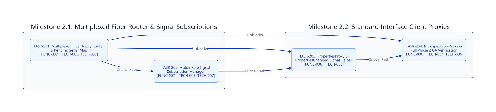

====================
Phase 2: Enhancement
====================

Timeline & Objectives
---------------------

Extend ``crystal-dbus-native`` in ``v0.4.0`` with a multiplexed fiber reply router eliminating head-of-line blocking across concurrent callers, channel-based ``AddMatch``/``RemoveMatch`` signal subscriptions, and typed client proxies for ``org.freedesktop.DBus.Properties`` and ``org.freedesktop.DBus.Introspectable``.

Phase 2 Dependency Graph
------------------------

Milestone 2.1: Multiplexed Fiber Router and Signal Subscriptions
----------------------------------------------------------------

* **TASK-201: Multiplexed Fiber Reply Router and Pending Serial Map**:

  - **Status**: Planned (``v0.4.0``)
  - **Fulfills**: ``[FUNC-007]``, ``[TECH-005]``, ``[TECH-007]``
  - **Blocked By**: ``TASK-105``
  - **Unblocks**: ``TASK-202``, ``TASK-203``, ``TASK-204``
  - **Scope**: Implement a dedicated background reader fiber and mutex-guarded ``Hash(UInt32, Channel(DBusMessage))`` pending reply table using buffered ``Channel(DBusMessage).new(1)`` channels and ``ensure`` cleanup so multiple fibers execute ``DBusConnection#call`` concurrently without head-of-line blocking, waking all pending channels on ``#close``.

* **TASK-202: Match-Rule Signal Subscription Manager**:

  - **Status**: Planned (``v0.4.0``)
  - **Fulfills**: ``[FUNC-007]``, ``[TECH-005]``, ``[TECH-007]``
  - **Blocked By**: ``TASK-201``
  - **Unblocks**: ``TASK-203``
  - **Scope**: Implement ``DBusConnection#subscribe_signal`` and ``#unsubscribe_signal`` issuing ``org.freedesktop.DBus.AddMatch`` and ``RemoveMatch`` bus calls and routing matching ``SIGNAL`` frames to bounded ``Channel(DBusMessage).new(64)`` subscriber channels.

Milestone 2.2: Standard Interface Client Proxies
------------------------------------------------

* **TASK-203: org.freedesktop.DBus.Properties Proxy and PropertiesChanged Signal Helper**:

  - **Status**: Planned (``v0.4.0``)
  - **Fulfills**: ``[FUNC-006]``, ``[TECH-006]``
  - **Blocked By**: ``TASK-201``, ``TASK-202``
  - **Unblocks**: ``TASK-204``
  - **Scope**: Implement ``PropertiesProxy`` wrapping ``Get`` (``ss -> v``), ``Set`` (``ssv -> void``), and ``GetAll`` (``s -> a{sv}``) with typed ``Variant`` unmarshaling, plus a ``PropertiesChanged`` signal helper (``sa{sv}as``) built on top of ``TASK-202``.

* **TASK-204: org.freedesktop.DBus.Introspectable Proxy and Full Phase 2 QA Verification**:

  - **Status**: Planned (``v0.4.0``)
  - **Fulfills**: ``[FUNC-006]``, ``[TECH-004]``, ``[TECH-006]``
  - **Blocked By**: ``TASK-201``, ``TASK-203``
  - **Unblocks**: None
  - **Scope**: Implement ``IntrospectableProxy#introspect`` returning the target object XML description and execute the full Phase 2 spec, Ameba, Flaw, and documentation verification suite.

Critical Path
-------------

``TASK-201 -> TASK-202 -> TASK-203 -> TASK-204``
