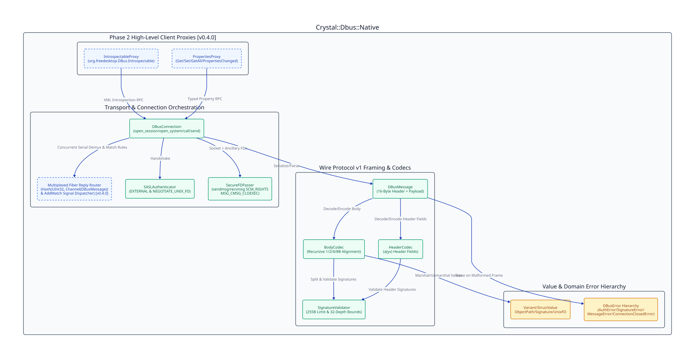

=====================
Architecture Overview
=====================

Requirement Mapping
-------------------

Fulfills ``[FUNC-001]``, ``[FUNC-002]``, ``[FUNC-003]``, ``[FUNC-004]``, ``[FUNC-005]``, ``[FUNC-006]``, and ``[FUNC-007]``.

System Architecture Diagram
---------------------------

Library Layout & Namespaces
---------------------------

The library source is organized under the ``Crystal::Dbus::Native`` namespace:

* ``src/crystal-dbus-native.cr``: Shard entrypoint and ``VERSION`` constant.
* ``src/crystal-dbus-native/errors.cr``: Domain exception hierarchy (``DBusError``, ``AuthError``, ``SignatureError``, ``MessageError``, ``ConnectionClosedError``).
* ``src/crystal-dbus-native/variant.cr``: Value-semantic structs (``ObjectPath``, ``Signature``, ``UnixFD``, ``StructValue``, ``Variant``) and recursive ``Value`` union alias.
* ``src/crystal-dbus-native/signature_validator.cr``: Recursive D-Bus signature validator and single-type splitter (``SignatureValidator``).
* ``src/crystal-dbus-native/header_codec.cr``: Header field array (``a(yv)``) parser and serializer (``HeaderCodec`` and ``HeaderField``).
* ``src/crystal-dbus-native/body_codec.cr``: General-purpose D-Bus wire body marshaler and unmarshaler (``BodyCodec``).
* ``src/crystal-dbus-native/dbus_message.cr``: Framed D-Bus wire message representation (``DBusMessage``, ``Endianness``, ``MessageType``).
* ``src/crystal-dbus-native/sasl_authenticator.cr``: Client-side SASL ``EXTERNAL`` and ``NEGOTIATE_UNIX_FD`` handshake (``SASLAuthenticator``).
* ``src/crystal-dbus-native/secure_fd_passer.cr``: ``SCM_RIGHTS`` ancillary file descriptor transport (``SecureFDPasser``).
* ``src/crystal-dbus-native/reply_router.cr``: Multiplexed fiber reply demultiplexer and match-rule signal dispatcher (``ReplyRouter``).
* ``src/crystal-dbus-native/dbus_connection.cr``: UNIX domain socket connection, multiplexed RPC ``call``, signal subscription manager, and FD passing (``DBusConnection``).
* ``src/crystal-dbus-native/proxies.cr``: Standard ``org.freedesktop.DBus.Properties`` and ``org.freedesktop.DBus.Introspectable`` client proxies (``PropertiesProxy`` and ``IntrospectableProxy``).

Technical Specifications
------------------------

* **[TECH-001] SASL Handshake and Transport Connection Orchestration** (Fulfills ``[FUNC-001]``, ``[FUNC-005]``):
  ``SASLAuthenticator`` sends the initial NUL byte and ``AUTH EXTERNAL <hex_uid>\r\n``, reads bounded CR-LF server responses up to 4096 bytes, optionally executes ``NEGOTIATE_UNIX_FD``, and issues ``BEGIN\r\n``. ``DBusConnection`` disables user-space socket buffering via ``@socket.sync = true`` and ``@socket.read_buffering = false``, completes the mandatory ``org.freedesktop.DBus.Hello`` RPC call in ``#start``, and guards serial generation and transport calls with ``Sync::Mutex``.

* **[TECH-002] Recursive Signature Validator and Alignment-Aware Wire Codecs** (Fulfills ``[FUNC-002]``, ``[FUNC-003]``):
  ``SignatureValidator`` enforces a 255-byte ceiling and independent 32-level nesting counters for ``ARRAY`` and ``STRUCT``/``DICT_ENTRY`` containers. ``HeaderCodec`` encodes and decodes the ``a(yv)`` header field array with 8-byte struct boundary alignment and pads the complete header to an 8-byte multiple. ``BodyCodec`` encodes and decodes arbitrary D-Bus payloads into a single ``IO::Memory`` stream so every 1, 2, 4, and 8-byte boundary is computed relative to the body origin, patching 4-byte array byte lengths in place and advancing to 8-byte alignment boundaries even for empty arrays of 8-byte elements (``a{sv}``, ``a(ii)``).

* **[TECH-003] Out-of-Band SCM_RIGHTS Ancillary File Descriptor Transport** (Fulfills ``[FUNC-004]``):
  ``SecureFDPasser`` wraps ``LibC.sendmsg`` and ``LibC.recvmsg`` with ``SOL_SOCKET``/``SCM_RIGHTS`` control messages, enforcing a maximum of 253 file descriptors per message, passing ``MSG_CMSG_CLOEXEC`` to atomically set ``FD_CLOEXEC`` on received descriptors, and closing all extracted descriptors whenever ``MSG_CTRUNC`` or header/body parsing fails.

* **[TECH-006] Standard Properties and Introspectable Client Proxy Architecture** (Fulfills ``[FUNC-006]``):
  ``PropertiesProxy`` wraps ``DBusConnection`` for a target ``destination`` and ``ObjectPath``, marshaling ``org.freedesktop.DBus.Properties.Get`` (signature ``ss``, returning ``Variant``), ``Set`` (signature ``ssv``), and ``GetAll`` (signature ``s``, returning ``Hash(String, Variant)``), and decoding ``PropertiesChanged`` (signature ``sa{sv}as``). ``IntrospectableProxy`` wraps ``org.freedesktop.DBus.Introspectable.Introspect`` (returning XML ``String``).

* **[TECH-007] Multiplexed Fiber Reply Router and Match-Rule Signal Dispatcher** (Fulfills ``[FUNC-007]``):
  A dedicated reader fiber demultiplexes inbound ``DBusMessage`` frames from ``DBusConnection`` via ``ReplyRouter``. ``METHOD_RETURN`` and ``ERROR`` frames are routed by ``reply_serial`` to per-call buffered ``Channel(DBusMessage).new(1)`` instances stored in a mutex-guarded ``Hash(UInt32, Channel(DBusMessage))``, eliminating head-of-line blocking across concurrent calling fibers. ``DBusConnection#call`` removes ``serial`` from ``Hash(UInt32, Channel(DBusMessage))`` under ``@mutex`` inside an ``ensure`` block on return, timeout, cancellation, or connection close so the reader fiber never blocks or leaks channels. Inbound ``SIGNAL`` frames are matched against registered filter predicates managed via ``org.freedesktop.DBus.AddMatch`` and ``RemoveMatch`` and delivered to bounded ``Channel(DBusMessage).new(64)`` subscriber channels.
